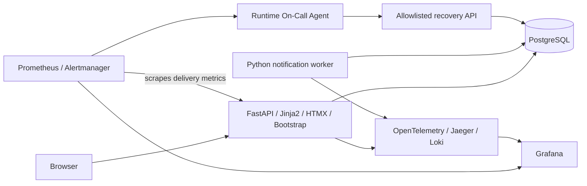

# FieldOps

Intelligent Technical Maintenance Intervention Management — final project for AI Dev Tools Zoomcamp 2026.

**Status (2026-11-13): T01–T15 are implemented and merged into `main` via PR #30; all seven CI checks pass on GitHub, and the main-release workflow published an immutable image digest (development deployment not enabled). The On-Call agent recovered a real incident with the owner's local Ollama `llama3.2:3b`. The demo video is published; no public deployment exists yet; see [Submission guide](docs/submission-guide.md) and [T15 final review](docs/t15-final-review.md). Verdict: LOCALLY COMPLETE — EXTERNAL ACCEPTANCE PENDING.**

**🎬 Demo video (1 min 33 s): [FieldOps v1.0 — Demo & Monitoring](https://github.com/chakirou18/final-project-AIzoomcamp-2026/releases/tag/v1.0.0-demo)**. It shows the FieldOps web interface, intervention creation and tracking, the Grafana monitoring dashboards, and previously validated delayed-notification alerting test evidence. It does not show a live On-Call agent run or a new live alert; that evidence is the recorded T11 real-model run documented in [T11 audit](docs/t11-audit.md).

Reviewers start here: [Submission guide](docs/submission-guide.md) · [Evidence index](docs/evidence-index.md) · [Demo script](docs/demo-script.md)

Small maintenance companies need to register jobs, assign technicians and track work through closure. Missed assignment notifications delay real work even when the application appears healthy. FieldOps makes both intervention progress and notification delivery visible.

Intended users are dispatchers who organize interventions, technicians who execute assignments, and operators who investigate delivery delays. The MVP is a single-company demonstration using synthetic data and seeded identities.

Owner-approved demo choices: separate manager (dispatcher) and technician identities, synthetic data, a paused-notification-delivery-loop incident and authenticated/audited On-Call operations. T01 documentation/public Issue publication is complete. Deployment, paid infrastructure and API purchases remain unauthorized.

The owner authorizes T11 local implementation and validation for [Issue #11](https://github.com/chakirou18/final-project-AIzoomcamp-2026/issues/11). Publication and the next task require owner review.

## Capabilities and journeys

- A dispatcher creates an intervention, sets its priority, assigns a technician and sees its history.
- A technician opens their persistent notification inbox, views assigned work, starts it and completes it.
- A dispatcher edits or cancels an eligible job and filters the list by status, priority or technician.
- An operator watches pending notifications, simulates a paused delivery worker and observes an alert, bounded agent recovery and an incident audit trail.

The dashboard summarizes all five statuses, unfinished work and delayed notification delivery. Delivery means that a notification becomes visible in the in-app inbox; browser reading is tracked separately. Email, SMS and push delivery are excluded.

## High-level architecture



Assignment, history and outbox insertion share one database transaction. A separate worker materializes inbox notifications. Docker Compose provides development and single-host deployment; GitHub Actions will test, build and deploy approved releases. See the architecture for exact trust boundaries and failure behavior.

## Objectives and documentation

Deliver a demonstrable full-stack MVP with reproducible tests, persistence, public deployment, CI/CD and evidence of user-impact detection and safe recovery. Maximum rubric coverage takes priority over the superseded 20-hour target. The revised remaining-work estimate is **78 engineering hours including contingency**, with a planning range of **58–117 hours**, plus already-spent T01 time (not measured). See the backlog for assumptions. Target the supplied **24/24** scoring baseline; the official rubric discrepancy must be resolved before claiming that this is the course maximum.

The proposed delivery policy is automatic PR validation, automatic development deployment after a validated merge to main, and manual production promotion with an approval gate. Development and production use separate databases, credentials and storage.

- [Product specification](docs/specification.md): requirements, stories and acceptance criteria.
- [Architecture](docs/architecture.md): data, APIs, reliability, operations and open decisions.
- [Development agent team](docs/agent-team.md): roles and handoffs.
- [Backlog](docs/backlog.md): dependencies, timeboxes and proposed Issues.
- [Rubric evidence](docs/rubric-evidence.md): scoring baseline, evidence and risks.
- [Repository instructions](AGENTS.md): context, testing and review conventions.
- [T01 audit](docs/t01-audit.md) and [local Issue drafts](docs/github-issue-drafts.md): readiness findings and implementation handoffs.
- [Final T01 readiness](docs/t01-readiness.md): current decision and validation summary.
- [T02 validation](docs/t02-validation.md): exact commands, acceptance evidence and known limitations.

## Local startup and tests

### Local observability (T09)

```sh
docker compose --profile observability up --build --wait
```

This adds Prometheus, Grafana, Loki, Alloy, the OpenTelemetry Collector, Jaeger and Alertmanager with a private authenticated test evidence receiver to the real API/worker/PostgreSQL stack. Default local URLs are [Grafana](http://127.0.0.1:3000/d/fieldops-operations) and [Jaeger](http://127.0.0.1:16686); only loopback UI ports are published. Change `FIELDOPS_SUBNET`, `FIELDOPS_PORT`, `FIELDOPS_GRAFANA_PORT`, `FIELDOPS_JAEGER_PORT` and `COMPOSE_PROJECT_NAME` together when sharing a host. Keep those values consistent across commands.

Grafana provisions thirteen real-data panels and bounded metric-to-log-to-trace links. The local anonymous role is Viewer, with Explore/transient inspection enabled; persistent dashboard writes remain denied. This is a local synthetic demo, not production authentication. The database-availability panel must be 1 before treating an empty backlog as healthy. Worker heartbeat freshness and pause state are separate signals. T10 supplies four notification alert rules and the authenticated receiver. T11 adds durable incident intake and an optional private processing service.

Application tracing is enabled in the local Compose stack and exports asynchronously; `FIELDOPS_TELEMETRY_ENABLED=false` opts out when running only the core app. Exporter/collector failure does not block assignment or inbox commits. `/metrics` remains web-owned even when the worker stops. The future hosted proxy must keep metrics/internal APIs private. Logs exclude payloads, secrets and SQL values, and Alloy has no Docker socket. Metrics/Loki stream labels never contain user, event or trace IDs.

Telemetry has separate volumes, 24-hour retention policies, bounded queues/log rotation and explicit CPU/memory caps. Retention is asynchronous, not a hard filesystem quota. Do not prune or delete application volumes to make space; on a small shared Docker host run expensive validation gates sequentially. See [T09 validation](docs/t09-validation.md) for actual component versions/digests, startup failures/corrections, trace JSON, tests, browser evidence and resource measurements.

The full-stack command `docker compose --profile observability --profile incident up --build --wait` starts the T11 incident processor with the existing monitoring services. Local startup is verified, and a real-model recovery was demonstrated with the provider variables above.


### Local notification alerting (T10)

The existing observability profile now evaluates queue age >60s with a 30s pending period and routes alerts through Alertmanager to a private authenticated evidence receiver. Missing metrics, failed scrapes and database snapshot unavailability have distinct alerts. Empty queue is never inferred from unavailable metrics. Detection/receipt/resolution never prove inbox recovery.

The receiver generates separate webhook/read credentials in dedicated volumes; no host port or business/control credentials are exposed. Inspect receipts using an authorized local test, not by publishing keys. The evidence volume caps at 10,000 rows and fails closed rather than silently deleting evidence. The operator pause requires local environment + DEMO_MODE + operator session + CSRF; manual generation-checked resume is cleanup only. No worker kill or autonomous remediation is used for T10.

```powershell
# Start/retain the exact explicitly synthetic project and port/subnet settings from validation.
$env:FIELDOPS_RUN_ALERTING_TESTS='1'
.venv/Scripts/python.exe -m pytest alerting_tests -v -s -p no:cacheprovider
```

See [T10 validation](docs/t10-validation.md) for promtool commands, exact timing, actual results, access restrictions and the acceptance matrix. Independent audit passed and feature publication is owner-authorized.

### Local On-Call recovery (T11)

The incident profile adds a private process and PostgreSQL incident history to the existing monitoring stack.

    docker compose --profile observability --profile incident up --build --wait

The default provider is unconfigured and blocked incidents escalate safely. An approved existing Ollama service is configured with FIELDOPS_ONCALL_PROVIDER=ollama, FIELDOPS_ONCALL_PROVIDER_URL, FIELDOPS_ONCALL_MODEL, FIELDOPS_ONCALL_PROVIDER_APPROVED=true and the bounded FIELDOPS_ONCALL_PROVIDER_TIMEOUT (5–30 s). The durable cumulative call budget defaults to one and output is limited to 1,024 tokens. The real-model demonstration used `llama3.2:3b` on CPU (structured output crashes this machine's Vulkan backend); see [T11 audit](docs/t11-audit.md). Model output is advisory: the deterministic policy and the application's execution guard decide.

An authenticated operator inspects GET /api/v1/incidents and GET /api/v1/incidents/{id}, then grants an incident/generation-specific authorization through POST /api/v1/incidents/{id}/authorize with CSRF. The agent's separate bearer can perform only a validated incident resume. Resolution requires the persisted action and independently verified outbox/inbox delivery across two healthy samples. See [T11 validation](docs/t11-validation.md) for the state machine, commands, mocked live result and remaining gate.

### Operational dashboard and controls (T07)

At `/app/operator`, enter the separately generated **operator** credential to access `/app/dashboard`.
For a local Compose demo, the owner can read it with
`docker compose exec -T web cat /run/fieldops-controls/operator_key`; never paste its value into
source, logs, screenshots or issue comments. The default stack supplies distinct operator and recovery
credential files without a copied `.env`. They are stored in a separate volume not mounted by the
notification worker. Outside Compose, configure distinct secrets or their readable file sources.

Only the operator sees global status/queue counts, oldest undelivered age and the worker heartbeat.
The controlled pause is demo-only, versioned, rate-limited and expires within ten minutes. Acknowledgment
means active claim/delivery transactions have finished and the shared gate is closed; heartbeat continues.
Running API readiness does not prove worker or delivery health.

`GET /internal/worker/status` and `POST /internal/worker/resume` require the distinct recovery Bearer
credential, not an operator session or webhook credential. Resume JSON contains only `incident_id`,
`expected_generation` and `idempotency_key` UUIDs (generation is an integer). Reuse the exact same key/body
for retries. Success and state commit atomically; changed key bindings or generations are rejected.
T11 binds incident UUIDs to durable incident records and scoped operator grants. The legacy recovery bearer remains available for explicit test cleanup.
Internal routes must remain private in a future deployment. T09 adds the telemetry profile described above;
See the local notification alerting section above and the validation document for the failure demonstration and limitations.

T08 test infrastructure supersedes the earlier retained-database policy: only databases owned by the current test run are cleaned. Existing application and historical audit data are preserved.


### Web workspace

Open `http://localhost:8000/` after startup (the isolated T05 validation stack uses
`http://127.0.0.1:18005/`). Select a synthetic manager or technician identity. This unrestricted
persona selector is demo authentication, unsuitable for production.

Managers can create, edit, assign/reassign, cancel, filter and inspect intervention history.
Technicians see only their assigned work, start/complete it with a resolution, and read the
persistent notification inbox. Historical assignment notifications do not grant job access.
All forms work with JavaScript disabled. Bootstrap 5.3.8 and HTMX 2.0.8 are served locally;
no CDN or frontend build is required at runtime.

### Reproducible testing (T08)

Only Docker Engine/Desktop (Linux containers), Docker Compose and network access for the first image build are required. No host Python, virtualenv, copied `.env`, pre-seeded app data or published application port is required:

```sh
docker compose --profile test run --build --rm tests
docker compose --profile browser run --build --rm browser-tests
```

The first command runs unit + real PostgreSQL tests. The second installs the lockfile-selected Playwright/Chromium inside its image, starts a test-only API and worker against a fresh isolated database, runs desktop/375px browser journeys with JavaScript on/off, then runs the 1,000-job/five-client/50-request N03 HTTP benchmark. Either command returns nonzero on a suite, benchmark or cleanup failure. The benchmark requires p95 strictly below one second with zero response errors.

Each execution writes `artifacts/t08-{backend|browser}-<run-id>/`: JUnit XML and a cleanup/exit summary, plus browser screenshots, redacted JSON logs and `n03-performance.json` for the browser runner. Failure screenshots mask password inputs; cookie-bearing traces, HAR and storage-state dumps are deliberately excluded. Artifacts remain ignored and local.

Test and browser PostgreSQL services have separate internal networks, no published ports, no application credential/data mounts, and bounded 512MiB tmpfs each. Their passwords are deliberately public synthetic test-only values. Each run uses random database names and ownership comments. Case/session finalizers remove only matching run-owned databases; the supervisor also cleans its own leftovers after failure. SIGTERM/SIGINT are handled; SIGKILL/daemon failure cannot execute a finalizer and may require owner inspection of that dedicated test service. No global Docker pruning or application volume cleanup is performed.

Two simultaneous runs in one Compose project use distinct database/run/artifact IDs. For separate checkouts or projects on the same host, choose unused `FIELDOPS_TEST_SUBNET` and `FIELDOPS_BROWSER_SUBNET` values and a distinct `COMPOSE_PROJECT_NAME`. Defaults are `10.250.0.0/24` and `10.250.1.0/24`; these explicit defaults also handle this host's exhausted automatic Docker address pools. Override an overlapping Docker/VPN route; do not prune unrelated networks. Test services may remain running between commands, but their run-owned databases are cleaned, preventing the former repeated-run tmpfs exhaustion.

Optional host-only checks after `uv sync --frozen`:

```powershell
uv run pytest -m "not container and not integration"
$env:FIELDOPS_RUN_CONTAINER_TESTS='1'
uv run pytest tests/test_container_lifecycle.py -v -s
```

The four opt-in Docker lifecycle cases create isolated projects with available subnets and fixed free host ports; they preserve their synthetic persistence volumes. They are excluded from the in-container backend runner because that runner has no Docker socket. Their report is a separate gate. See [T08 validation](docs/t08-validation.md) for the inventory, exact counts and actual measurements.


Prerequisites: a running Docker Engine/Desktop in Linux-container mode and Docker Compose. From the repository root, `docker compose up --build --wait` builds the pinned Python image, generates a local-only database password in a named volume, starts PostgreSQL, runs the Alembic migrations through T07 and idempotent synthetic persona seed, and starts the API plus a separate leased outbox worker. **No .env copy or manual migration/seed command is needed.** Optional overrides belong in an ignored .env; .env.example contains placeholders, not usable credentials. Keep defaults for the first run; do not copy placeholder values unchanged.

| Purpose | Command | Status |
| --- | --- | --- |
| API + worker + PostgreSQL + bootstrap | `docker compose up --build --wait` | Existing domain/UI/control stack; see T04-T07 validation |
| Unit + real PostgreSQL integration tests | `docker compose --profile test run --build --rm tests` | T02-T08 regressions; owned disposable test databases |
| Complete required demo stack | `docker compose --profile observability --profile incident up --build --wait` | Observability implemented in T09; real incident/agent profile remains NOT TESTED until T11 |
| Browser tests | `docker compose --profile browser run --build --rm browser-tests` | T08 isolated Chromium suite + N03 benchmark |

API: [liveness](http://127.0.0.1:8000/health/live), [readiness](http://127.0.0.1:8000/health/ready), [OpenAPI UI](http://127.0.0.1:8000/docs). The base stack publishes only localhost port 8000; PostgreSQL has no host port. The observability profile additionally publishes loopback Grafana/Jaeger UI ports. Readiness returns 503 when its SELECT 1 fails, while liveness remains 200. Responses/logs never include passwords or connection strings. JSON logs use active SDK trace/span IDs when T09 tracing is enabled, and null outside active spans.

`docker compose restart db web worker` restarts the running services. `docker compose down` stops/removes this project's containers/network while retaining its database and credential volumes; restarting with up reuses them. Do not delete either volume unless intentionally resetting this local environment. A credential volume and its database volume must be kept together. Database/user defaults are local-development values, not production privilege design.

This machine's Docker default address pools were exhausted. Compose uses a configurable private subnet (default 10.240.0.0/24) without pruning any unrelated networks. If it overlaps an existing Docker/VPN/network route, set FIELDOPS_SUBNET to a free CIDR in the ignored .env. FIELDOPS_PORT overrides localhost port 8000 if occupied.

For Python-only unit tests, install/use Python 3.12 and uv, run `uv sync --frozen`, then `uv run pytest -m "not container and not integration"`. See T02 validation for the opt-in Docker lifecycle tests (real outage, restart and recreation persistence), lint commands and migration/seed entry points. No model access is needed through T06. Operator activation already requires a locally configured secret; workflow fixtures and provider access remain future tasks.

Lifecycle tests remove only their generated containers/network; their named volumes and synthetic persistence probe remain for owner inspection. Repeated runs therefore retain additional test volumes. Do not delete them without owner authorization.

## T03 sessions and contracts

Local bootstrap creates four synthetic identities (dispatcher, two technicians, operator), without passwords or intervention fixtures. Manager means dispatcher. `/auth/personas` lists active nonoperator personas. GET `/auth/csrf`, keep its cookie and returned token, then POST `/auth/login` with persona_id and X-CSRF-Token. GET `/auth/session` or `/session` inspects the active identity. POST `/auth/logout` requires the session CSRF token and revokes the database session. HTML POST adapters are `/session/login` and `/session/logout`, using a csrf_token form field. These are session infrastructure, not the T05 application UI.

Local Compose generates a separate session signing key in its credential volume. Optional FIELDOPS_OPERATOR_SECRET must be at least 32 characters to activate the operator; absent/weak/wrong secrets deny access. Never commit it. Nonlocal cookies require HTTPS; local HTTP is explicitly development-only. Nonlocal startup migrates without seeding; explicit `python -m fieldops.bootstrap seed --allow-nonlocal` is a separate operator action, not authorized for an actual production environment here. Demo activation is disabled by default outside the supplied local Compose configuration.

Live `/docs` describes implemented versioned intervention routes. GET `/contracts/openapi.json` includes lifecycle request examples and marks implemented operations; the JSON notification inbox/read operations are also implemented. See [permission and API contracts](docs/t03-contracts.md) and [T04 validation](docs/t04-validation.md) for endpoints, commands, evidence and limitations. T04 adds shared transactional services without changing T03 migrations. T06 implements the leased worker/persistent JSON inbox, and T05 provides the manager/technician HTML workflows at `/app/login`.

## T06 leased notification delivery

`python -m fieldops.worker` runs a separate process using the existing application image. It polls every two seconds, claims at most 20 events with SKIP LOCKED, grants a unique 30-second lease token and consumes one of five attempts per committed claim. Delivery inserts the unique inbox row and marks the matching outbox event delivered in one transaction. Stale or expired tokens cannot complete. Failed delivery retries after 2/4/8/16 seconds; a fifth failure or fifth expired claim stays failed and undelivered. Database outages use bounded reconnect backoff.

Authenticated technicians use GET `/api/v1/notifications` and POST `/api/v1/notifications/{id}/read` (session plus CSRF). Historical assignments retain an immutable ID/version summary but do not grant access to reassigned jobs. The worker has no exposed port or HTTP health endpoint; process startup is not proof of inbox delivery. T07 adds database-backed controls/heartbeat; T09 adds tracing/exporters and telemetry services. T10 adds alert rules and a private test receiver; T11 agent work remains deferred.

[Issue #5 implementation evidence](docs/t06-validation.md) records PostgreSQL concurrency/crash tests, Docker outage/restart checks, benchmark measurements and limitations. Never delete existing volumes to run tests.

## AI agent behavior

An Alertmanager webhook creates a durable incident. The agent collects fixed, bounded telemetry and asks the model for one schema-validated diagnosis. A deterministic policy, not the model, decides whether recovery is allowed. An operator must then grant that specific incident and pause generation. The agent performs a single allowlisted `resume_notification_worker` with a stable idempotency key. It resolves the incident only after the affected outbox events show delivered inbox rows across two healthy samples. Log text never reaches the prompt, and the model cannot choose tools, URLs, SQL or shell commands. Details: [T11 validation](docs/t11-validation.md), [T11 audit](docs/t11-audit.md).

## CI/CD

`.github/workflows/` holds five workflows:

- reusable PR checks: lint, unit tests, PostgreSQL integration with a mock model, dependency audit, rules, Chromium and image build;
- PR validation;
- validated-main release, which publishes an immutable GHCR digest and deploys development automatically;
- manual production promotion of a development-tested digest behind a required-reviewer environment;
- manual rollback.

PR checks have run for real on PRs #26–#29. Main-branch deployment, environments and branch protection await owner configuration. See [T12 validation](docs/t12-validation.md) and [GitHub release readiness](docs/github-release-readiness.md).

## Deployment

The hosting kit includes:

- a digest-pinned hosted override and a Caddy HTTPS edge;
- a private model runtime on an internal network;
- release, backup-verification, exposure and capacity scripts.

The full target is development and production side by side plus the model. It needs about 8 GB RAM and 4 vCPU, so it does not fit a €5/month server; the costed proposal is in [T13 hosting proposal](docs/t13-hosting-proposal.md). **No public URL exists yet.** See [T13 deployment](docs/t13-deployment.md) and [T13 rollback](docs/t13-rollback.md).

## Security

- **Synthetic data only.** Demo personas are synthetic; the operator persona needs a locally generated secret.
- **Session protection.** Sessions use signed HttpOnly cookies, which are Secure outside `local`. CSRF protection applies to every mutation, and roles are checked server-side.
- **Private surfaces.** Metrics, controls, internal and agent endpoints are private.
- **Secret handling.** CI pins actions by SHA and passes secrets only through `env:`. A secret scan runs on every PR.
- **Agent isolation.** The agent's database role cannot read business tables or modify grants, and the agent has no shell or Docker socket.

## Known limitations

- **Local only.** Hosting, the production approval record and a rollback rehearsal are pending owner approval.
- **Video scope.** The published video covers the web interface, interventions, Grafana and previously validated alerting evidence; it does not show a live agent recovery or a new live alert.
- **Weak model.** The 3B model is advisory and unreliable on counterfactual evidence; the policy compensates.
- **CPU inference.** Inference must run on CPU on the development machine, because structured output crashed its GPU backend.
- **Untested cases.** Five worker-stop cases and one database-deletion assertion are not executed, under the data-preservation rule.

## Evidence and submission

- [Submission guide](docs/submission-guide.md)
- [Evidence index (F01–F10, N01–N07)](docs/evidence-index.md)
- [Rubric evidence (24-point mapping)](docs/rubric-evidence.md)
- [T15 final review](docs/t15-final-review.md)
- [Final release checklist](docs/final-release-checklist.md)

- [Demo video — release v1.0.0-demo](https://github.com/chakirou18/final-project-AIzoomcamp-2026/releases/tag/v1.0.0-demo)

There is no public demo URL yet; it will be added only once one exists.
