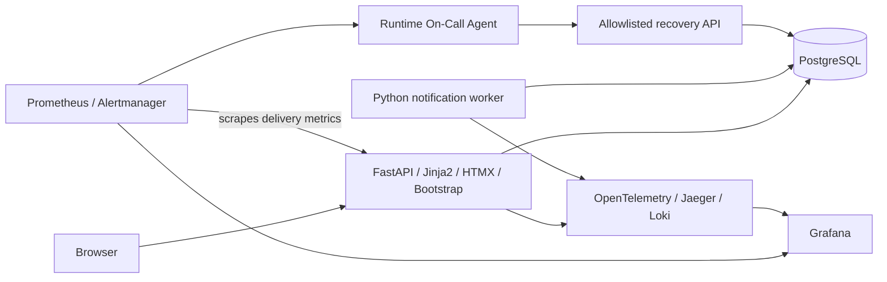

# FieldOps

Intelligent Technical Maintenance Intervention Management — final project for AI Dev Tools Zoomcamp 2026.

**Status: T01 — specification and architecture only.** No application, deployment, tests or operational evidence exists yet. Repository: [chakirou18/final-project-AIzoomcamp-2026](https://github.com/chakirou18/final-project-AIzoomcamp-2026).

Small maintenance companies need to register jobs, assign technicians and track work through closure. Missed assignment notifications delay real work even when the application appears healthy. FieldOps makes both intervention progress and notification delivery visible.

Intended users are dispatchers who organize interventions, technicians who execute assignments, and operators who investigate delivery delays. The MVP is a single-company demonstration using synthetic data and seeded identities.

Owner-approved demo choices: separate manager (dispatcher) and technician identities, synthetic data, a paused-notification-delivery-loop incident and authenticated/audited On-Call operations. Documentation and public Issue publication are authorized; application development, deployment, paid infrastructure and API purchases are not.

## Capabilities and journeys

- A dispatcher creates an intervention, sets its priority, assigns a technician and sees its history.
- A technician opens their persistent notification inbox, views assigned work, starts it and completes it.
- A dispatcher edits or cancels an eligible job and filters the list by status, priority or technician.
- An operator watches pending notifications, simulates a paused delivery worker and observes an alert, bounded agent recovery and an incident audit trail.

The dashboard summarizes all five statuses, unfinished work and delayed notification delivery. Delivery means that a notification becomes visible in the in-app inbox; browser reading is tracked separately. Email, SMS and push delivery are excluded.

## High-level architecture

Assignment, history and outbox insertion share one database transaction. A separate worker materializes inbox notifications. Docker Compose provides development and single-host deployment; GitHub Actions will test, build and deploy approved releases. See the architecture for exact trust boundaries and failure behavior.

## Objectives and documentation

Deliver a demonstrable full-stack MVP with reproducible tests, persistence, public deployment, CI/CD and evidence of user-impact detection and safe recovery. Maximum rubric coverage takes priority over the superseded 20-hour target. The revised remaining-work estimate is **78 engineering hours including contingency**, with a planning range of **58–117 hours**, plus already-spent T01 time (not measured). See the backlog for assumptions. Target the supplied **24/24** scoring baseline; the official rubric discrepancy must be resolved before claiming that this is the course maximum.

The proposed delivery policy is automatic PR validation, automatic development deployment after a validated merge to main, and manual production promotion with an approval gate. Development and production use separate databases, credentials and storage.

- [Product specification](docs/specification.md): requirements, stories and acceptance criteria.
- [Architecture](docs/architecture.md): data, APIs, reliability, operations and open decisions.
- [Development agent team](docs/agent-team.md): roles and handoffs.
- [Backlog](docs/backlog.md): dependencies, timeboxes and proposed Issues.
- [Rubric evidence](docs/rubric-evidence.md): scoring baseline, evidence and risks.
- [Repository instructions](AGENTS.md): context, testing and review conventions.
- [T01 audit](docs/t01-audit.md) and [local Issue drafts](docs/github-issue-drafts.md): readiness findings and implementation handoffs.
- [Final T01 readiness](docs/t01-readiness.md): current decision and validation summary.

## Proposed single-command workflows

These commands are **design proposals, not verified instructions**: no Compose files, images or test runners exist yet. Docker Compose is the intended prerequisite; implementation must verify first-run migrations, synthetic seed and service readiness inside the startup dependency graph.

| Purpose | Proposed command |
| --- | --- |
| Application, worker and PostgreSQL | `docker compose up --build --wait` |
| Complete required demo stack | `docker compose --profile observability --profile incident up --build --wait` |
| Unit and PostgreSQL integration tests together | `docker compose --profile test run --build --rm tests` |
| Browser tests | `docker compose --profile browser run --build --rm browser-tests` |

Test profiles use disposable, separately named databases; the browser profile adds its own test web/worker pair. Neither uses the developer or production database. The complete demo requires configured model and operator credentials; tests use a labeled model stub. See the architecture for the proposed runner and profile contracts. No command above has been executed.

Verified setup instructions, live URL and demo access details will be added only after implementation and validation. T01 publication covers these documents and the reviewed public tracker; later implementation, dependency installation and deployment require owner authorization.
