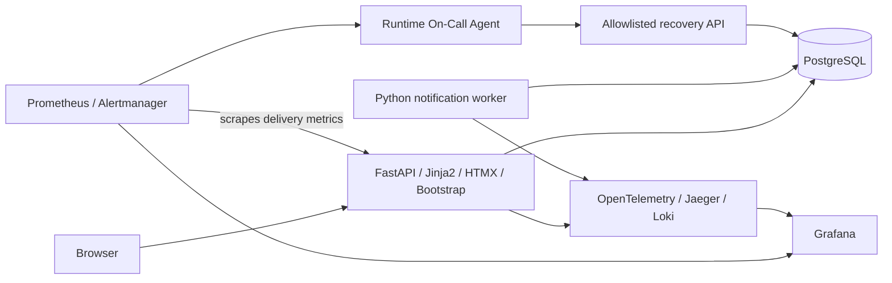

# FieldOps

Intelligent Technical Maintenance Intervention Management — final project for AI Dev Tools Zoomcamp 2026.

**Status: T03 passed independent audit; feature-branch publication authorized, PR review pending. T02 PR #16 remains open/unmerged.** Database models, session boundaries and draft lifecycle contracts are implemented; business workflows remain planned.

Small maintenance companies need to register jobs, assign technicians and track work through closure. Missed assignment notifications delay real work even when the application appears healthy. FieldOps makes both intervention progress and notification delivery visible.

Intended users are dispatchers who organize interventions, technicians who execute assignments, and operators who investigate delivery delays. The MVP is a single-company demonstration using synthetic data and seeded identities.

Owner-approved demo choices: separate manager (dispatcher) and technician identities, synthetic data, a paused-notification-delivery-loop incident and authenticated/audited On-Call operations. T01 documentation/public Issue publication is complete. Deployment, paid infrastructure and API purchases remain unauthorized.

Current authorization: **T03 / [Issue #3](https://github.com/chakirou18/final-project-AIzoomcamp-2026/issues/3) feature-branch publication only**, with a PR from feature/t03-schema-contracts to feature/t02-foundation and an Issue progress comment. Merge, Issue closure, T04 implementation and deployment require separate authorization. See [T03 validation](docs/t03-validation.md) and [T02 evidence](docs/t02-validation.md).

## Capabilities and journeys

- A dispatcher creates an intervention, sets its priority, assigns a technician and sees its history.
- A technician opens their persistent notification inbox, views assigned work, starts it and completes it.
- A dispatcher edits or cancels an eligible job and filters the list by status, priority or technician.
- An operator watches pending notifications, simulates a paused delivery worker and observes an alert, bounded agent recovery and an incident audit trail.

The dashboard summarizes all five statuses, unfinished work and delayed notification delivery. Delivery means that a notification becomes visible in the in-app inbox; browser reading is tracked separately. Email, SMS and push delivery are excluded.

## High-level architecture

Assignment, history and outbox insertion share one database transaction. A separate worker materializes inbox notifications. Docker Compose provides development and single-host deployment; GitHub Actions will test, build and deploy approved releases. See the architecture for exact trust boundaries and failure behavior.

## Objectives and documentation

Deliver a demonstrable full-stack MVP with reproducible tests, persistence, public deployment, CI/CD and evidence of user-impact detection and safe recovery. Maximum rubric coverage takes priority over the superseded 20-hour target. The revised remaining-work estimate is **78 engineering hours including contingency**, with a planning range of **58–117 hours**, plus already-spent T01 time (not measured). See the backlog for assumptions. Target the supplied **24/24** scoring baseline; the official rubric discrepancy must be resolved before claiming that this is the course maximum.

The proposed delivery policy is automatic PR validation, automatic development deployment after a validated merge to main, and manual production promotion with an approval gate. Development and production use separate databases, credentials and storage.

- [Product specification](docs/specification.md): requirements, stories and acceptance criteria.
- [Architecture](docs/architecture.md): data, APIs, reliability, operations and open decisions.
- [Development agent team](docs/agent-team.md): roles and handoffs.
- [Backlog](docs/backlog.md): dependencies, timeboxes and proposed Issues.
- [Rubric evidence](docs/rubric-evidence.md): scoring baseline, evidence and risks.
- [Repository instructions](AGENTS.md): context, testing and review conventions.
- [T01 audit](docs/t01-audit.md) and [local Issue drafts](docs/github-issue-drafts.md): readiness findings and implementation handoffs.
- [Final T01 readiness](docs/t01-readiness.md): current decision and validation summary.
- [T02 validation](docs/t02-validation.md): exact commands, acceptance evidence and known limitations.

## Local startup and tests

Prerequisites: a running Docker Engine/Desktop in Linux-container mode and Docker Compose. From the repository root, `docker compose up --build --wait` builds the pinned Python image, generates a local-only database password in a named volume, starts PostgreSQL, runs the T03 Alembic migration and idempotent synthetic persona seed, and waits for API readiness. **No .env copy or manual migration/seed command is needed.** Optional overrides belong in an ignored .env; .env.example contains placeholders, not usable credentials. Keep defaults for the first run; do not copy placeholder values unchanged.

| Purpose | Command | Status |
| --- | --- | --- |
| Foundation API + PostgreSQL + bootstrap | `docker compose up --build --wait` | Verified in T02; worker deferred to T06 |
| Unit + real PostgreSQL integration tests | `docker compose --profile test run --build --rm tests` | Verified in T02; disposable test DB, no business fixtures |
| Complete required demo stack | `docker compose --profile observability --profile incident up --build --wait` | Proposed; telemetry/agent profiles do not exist yet |
| Browser tests | `docker compose --profile browser run --build --rm browser-tests` | Proposed; browser profile does not exist yet |

API: [liveness](http://127.0.0.1:8000/health/live), [readiness](http://127.0.0.1:8000/health/ready), [OpenAPI UI](http://127.0.0.1:8000/docs). Only localhost port 8000 is published; PostgreSQL has no host port. Readiness returns 503 when its SELECT 1 fails, while liveness remains 200. Responses/logs never include passwords or connection strings. JSON application logs currently use null trace IDs; real tracing belongs to T09.

`docker compose restart db web` restarts the running services. `docker compose down` stops/removes this project's containers/network while retaining its database and credential volumes; restarting with up reuses them. Do not delete either volume unless intentionally resetting this local environment. A credential volume and its database volume must be kept together. Database/user defaults are local-development values, not production privilege design.

This machine's Docker default address pools were exhausted. Compose uses a configurable private subnet (default 10.240.0.0/24) without pruning any unrelated networks. If it overlaps an existing Docker/VPN/network route, set FIELDOPS_SUBNET to a free CIDR in the ignored .env. FIELDOPS_PORT overrides localhost port 8000 if occupied.

For Python-only unit tests, install/use Python 3.12 and uv, run `uv sync --frozen`, then `uv run pytest -m "not container and not integration"`. See T02 validation for the opt-in Docker lifecycle tests (real outage, restart and recreation persistence), lint commands and migration/seed entry points. No model access is needed for T03. Operator activation already requires a locally configured secret; workflow fixtures and provider access remain future tasks.

Lifecycle tests remove only their generated containers/network; their named volumes and synthetic persistence probe remain for owner inspection. Repeated runs therefore retain additional test volumes. Do not delete them without owner authorization.

## T03 sessions and contracts

Local bootstrap creates four synthetic identities (dispatcher, two technicians, operator), without passwords or intervention fixtures. Manager means dispatcher. `/auth/personas` lists active nonoperator personas. GET `/auth/csrf`, keep its cookie and returned token, then POST `/auth/login` with persona_id and X-CSRF-Token. GET `/auth/session` or `/session` inspects the active identity. POST `/auth/logout` requires the session CSRF token and revokes the database session. HTML POST adapters are `/session/login` and `/session/logout`, using a csrf_token form field. These are session infrastructure, not the T05 application UI.

Local Compose generates a separate session signing key in its credential volume. Optional FIELDOPS_OPERATOR_SECRET must be at least 32 characters to activate the operator; absent/weak/wrong secrets deny access. Never commit it. Nonlocal cookies require HTTPS; local HTTP is explicitly development-only. Nonlocal startup migrates without seeding; explicit `python -m fieldops.bootstrap seed --allow-nonlocal` is a separate operator action, not authorized for an actual production environment here. Demo activation is disabled by default outside the supplied local Compose configuration.

Live `/docs` describes available routes. GET `/contracts/openapi.json` returns the **draft** lifecycle OpenAPI, with request examples and x-implemented=false; workflow routes are not registered. See [permission and API contracts](docs/t03-contracts.md). T04 will implement these operations. Existing T02 validation is historical; current schema/bootstrap tests intentionally expect T03 tables.
