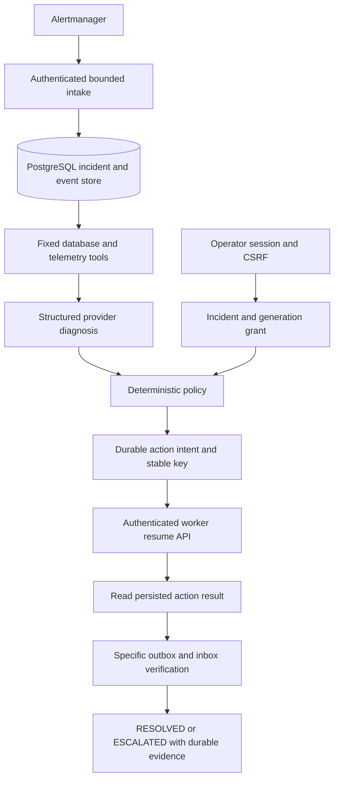

# T11 implementation and local validation

Task is [Issue #11](https://github.com/chakirou18/final-project-AIzoomcamp-2026/issues/11), F08/F09/N04/N05. Work is local on `feature/t11-oncall-agent` from published T10 `7b6889cfdc5116266c3bcbc8d572c4bd3a76931b`, PR #24 open/unmerged. T09/T10 evidence and Git baselines are preserved.

> **Audit update 2026-11-11 (Claude takeover):** real-model acceptance **PASSED** with the owner's existing local Ollama `llama3.2:3b` at zero cost (incident `cfa129e9-274c-4040-9319-3777025e7da0`, one durable `model_intent`, RESOLVED after verified delivery). Two defects were corrected (post-model freshness check; budget reserved before the evidence pre-check), the provider timeout became a bounded setting, and the prompt now carries field semantics. See [T11 audit](t11-audit.md) for findings, the live timeline, the corrected ledger and the CONDITIONAL GO verdict. The historical Codex text below is retained unchanged.

**Historical status before the audit:** Provider configuration names were absent from the process environment. The owner was asked to identify an approved existing provider and call/token or spend limit. An Ollama executable existed locally, but its model-list command failed with access denied (root cause found in the audit: a damaged folder ACL). No model was downloaded or purchased. The production adapter is implemented and deterministic tests cover it. The live success below used `deterministic-test-only` diagnosis.

## Architecture and state machine



The application owns business/control reads and mutations. The private intake extends the T10 receiver by committing a PostgreSQL episode before committing its existing bounded SQLite test receipt and returning 202. The agent role can write incidents, append events, insert affected IDs and insert action intents. Grants are read-only to that role. It has no business-table read/write privileges, operator credential, legacy recovery credential or Docker socket. The existing T10 receipt volume and endpoints are retained for regression evidence.

Stages are `RECEIVED → DIAGNOSING → DIAGNOSED → ACTION_PENDING → ACTION_IN_PROGRESS → VERIFYING → RESOLVED`. Each nonterminal state permits escalation. PostgreSQL rejects illegal state changes. Terminal incidents cannot reopen. Resolved alert messages update receipt status and never resolve incidents. Late firing replays cannot reverse a resolved alert status.

The polling process acquires a 45-second fenced lease with SKIP LOCKED, commits before external I/O and releases ownership after one durable stage. Ordering by last processed time prevents an unapproved incident from starving newer work. A lost lease prevents its owner from writing a later stage. The overall incident deadline is 240 seconds. Verification is independently capped at 120 seconds and requires two healthy observations at least five seconds apart.

## Durable contracts and migration

Migration `0004_t11_incidents` adds the following tables without modifying existing outbox/inbox rows.

| Table | Contract |
|---|---|
| incidents | UUID, canonical episode hash UNIQUE, safe labels, alert name/status/start, first/latest seen, state, generation, snapshots, diagnosis, verification, escalation, close/resolution timestamps, lease, processing order, deadline and one reserved model attempt |
| incident_events | Append-only typed transitions and bounded evidence with incident UUID and UTC timestamp |
| incident_affected | Composite incident/outbox primary key and expected recipient, up to 1,000 events per incident |
| incident_grants | Operator ID, one grant per incident, fixed resume action, generation, creation/expiry and revocation |
| incident_actions | Stable UUID idempotency key, one intent per incident, grant/generation, application-recorded success and completion time |

Episode identity hashes canonical allowlisted labels plus normalized UTC startsAt. Intake serializes capacity checks and duplicate upserts in a short PostgreSQL transaction. Replays update latest-seen time without another diagnosis or action. At 10,000 incidents, intake fails closed and retains previous evidence. Existing episodes continue to deduplicate. There is no automatic incident deletion.

The DB resolution trigger requires a matching successful application resume result, a valid grant at execution time, known affected IDs with delivered outbox rows and correct inbox recipients, and positive verification evidence. State and audit events commit together. A failed audit commit rolls back the state. Migration downgrade refuses a database containing incidents. Empty run-owned migration fixtures retain their existing downgrade/reapply coverage.

Before the synthetic application's additive migration, `pg_dump -Fc` saved a 211,724-byte backup to ignored `artifacts/t11-pre-migration-t10.dump`. Migration and role provisioning completed with exit code zero. All fixture databases and new credential volumes are retained.

## Provider and diagnosis contract

`Provider` is a small protocol. `OllamaProvider` sends an explicitly approved model a bounded structured-output request. `UnconfiguredProvider` raises a typed failure. Runtime configuration defaults to unconfigured, which escalates safely. The deterministic provider exists in test code.

Diagnosis validates incident UUID, category, evidence references, confidence, fixed proposed action, explanation, risk, required operator authorization and escalation recommendation. Categories include paused delivery, unavailable worker, unavailable database, missing telemetry, ambiguous and unknown. A model output cannot choose a URL, SQL statement, shell command or arbitrary API. Explanation text is persisted as bounded data.

The adapter permits one attempt per incident, a 20-second request timeout, 16 KiB maximum request, 32 KiB maximum response, 4,096-token context configuration and 1,024 output tokens by default, capped at 2,048. An approved real provider also has a durable total reservation budget, default one call and maximum ten. Model-intent events reserve that budget transactionally across incidents, concurrent processors and restarts. Failed or interrupted reservations remain consumed. Raising the configured cumulative budget requires an explicit owner decision.

Only operational aggregates, sanitized log/trace counts and bounded prior incident/action metadata enter prompts. Recipient identities, job descriptions/sites, credentials, raw logs, raw trace attributes and alert annotations are excluded. The system prompt treats all evidence as untrusted data. Provider output is validated independently, and deterministic action checks apply even to a confident diagnosis.

Adapter details were checked against [Ollama chat](https://docs.ollama.com/api/chat) and [structured-output documentation](https://docs.ollama.com/capabilities/structured-outputs).

## Telemetry tools

| Tool | Bounds and behavior |
|---|---|
| Application evidence | Recovery-scoped private endpoint, repeatable-read snapshot, UTC observation, current DB availability, queue count/age, pause/generation/expiry, fresh heartbeat |
| Affected outbox/inbox | UUID cursor pages of 100, ten-page/1,000-event cap. IDs, recipients, status, delivery timestamp, inbox identity/count and validated trace ID only. Reject changed/incomplete captures. |
| Prometheus | Fixed query for count, oldest age, DB-up and scrape-up. Missing/unhealthy evidence prevents action. |
| Loki | Fixed service/validated event-ID query, 15-minute window and maximum 100 lines. Only allowlisted event counts survive parsing. Raw malicious instructions are discarded. |
| Jaeger | At most three known trace IDs, bounded response and span list, retain only enqueue presence and sample counts |
| Prior evidence | Agent-owned incident/action tables, at most 20 event metadata records and fixed aggregates |
| Reconciliation | Read the persisted worker action result by its known stable key |

HTTP tools use three-second timeouts, a 512 KiB response cap and denied redirects. Errors distinguish DB unavailability, authorization denial, HTTP failure, timeout, schema failure and unstable/oversized queue capture. Unavailable telemetry cannot become an empty healthy queue. Snapshots older than 15 seconds are denied.

## Authorization and constrained execution

The operator inspects `GET /api/v1/incidents` and `GET /api/v1/incidents/{id}`. POST `/api/v1/incidents/{id}/authorize` requires an active operator session, CSRF, local DEMO_MODE, a diagnosed firing incident and expected generation. Grants expire in at most five minutes and are also bounded by the incident deadline. POST `.../revoke` records revocation. Expired/revoked grants cannot be silently renewed.

The action allowlist contains only `resume_notification_worker`. The agent has a distinct file-backed bearer, generated independently of operator and legacy recovery credentials. That scope cannot resume an unknown incident. The existing `POST /internal/worker/resume` route validates the incident, intent, grant identity/expiry/revocation, operator activity, current generation, paused/nonexpired gate, fresh heartbeat and affected pending events while holding the exclusive worker gate. Success, gate update, worker action result and incident action outcome commit in the same transaction.

Intent and UUID5 key are durable before transmission. ACTION_IN_PROGRESS survives process loss. Reconciliation reads the application result before verification. An ambiguous timeout never causes a blind second transmission. Missing or inconsistent persisted results escalate. The positive test injected a timeout after a real PostgreSQL commit and observed one effective resume.

Resolution requires matching success, fresh worker and expected generation, every affected outbox delivered timestamp, exactly one correct-recipient inbox per event, zero backlog and zero oldest age across the healthy observation interval. Natural drain, auto-expiry, alert disappearance, a model explanation and an HTTP 200 alone cannot meet these checks.

## Real monitoring and mocked diagnosis demonstration

The successful live case used actual Prometheus → Alertmanager → authenticated intake, real PostgreSQL writes, actual operator authorization and the real scoped resume endpoint. Diagnosis was deterministic test inference.

| Correlation | Value |
|---|---|
| Incident | e8d23b24-8bd7-48ee-a4c3-0cbd8439697b |
| Outbox | 26d95a61-df79-43e5-b09c-6215d68a4510 |
| Pause generation | 24 |
| Operator grant | a33b1bf8-51d3-430b-8e19-8859f5afe7cd |
| Stable action key | 2d18117c-22eb-5714-80e8-be7af9e94de3 |
| Inbox | a9f8a1b2-3e57-427e-b2cc-163be0c0a75b |
| Distributed trace | d8b95f27775a7e076a14eff5068ae9af |

| Event | UTC on 2026-11-11 |
|---|---|
| Pause acknowledgement effective | 08:23:12.699658 |
| Assignment request began | 08:23:12.708524 |
| Outbox creation read after commit | 08:23:12.789178 |
| Durable incident received | 08:24:53.639110 |
| Mock diagnosis persisted | 08:25:04.061111 |
| Operator grant persisted | 08:25:06.588901 |
| Authorized application resume recorded | 08:25:07.368732 |
| Matching inbox delivery | 08:25:08.264831 |
| First positive verification after process restart | 08:25:17.224837 |
| Positive verification and RESOLVED persisted | 08:25:22.335821 |

The intake was observed **101.016 seconds monotonic** after starting the assignment request. Inbox absence was checked before diagnosis. After the agent recorded success, the first processor exited in VERIFYING and a fresh process completed positive verification using the same persisted key. Exactly one successful application action and one inbox row were found. A correlated real web/worker trace was retrieved. [Transcript](../artifacts/t11-live-a50f4cf158114cdd8359a8c69d0aa2bd/evidence.json), [live JUnit](../artifacts/t11-complete-live.xml)

The initial live attempt diagnosed correctly but failed when SELECT FOR UPDATE on the grant table required a privilege deliberately withheld from the agent. The unnecessary agent-side lock was removed. The application retains the grant lock inside the execution transaction. That failed run used explicit manual test cleanup and produced no agent resolution. Its failed JUnit and logs are retained in `artifacts/t11-live-mock-first.xml`.

## Startup and validation commands

Use the retained synthetic T10 project configuration in `artifacts/t10-env.ps1`. The new observability dependency provisions only the incident DB role and dedicated credentials after the application migration. The incident profile starts the private processing service. Without an approved provider it remains operational for durable intake/escalation, and real diagnosis stays blocked.

```powershell
. ./artifacts/t10-env.ps1
docker compose --profile observability --profile incident build web
docker compose --profile observability --profile incident up --no-deps --wait web alert-receiver oncall-agent
docker compose --profile observability --profile incident up --no-recreate --no-build --wait --wait-timeout 120
$env:FIELDOPS_RUN_AGENT_TESTS='1'
.venv/Scripts/python.exe -m pytest agent_tests/test_live.py -v -s -p no:cacheprovider --tb=short --junitxml=artifacts/t11-complete-live.xml
$p='artifacts/t11-final-unit-'+[guid]::NewGuid()
.venv/Scripts/python.exe -m pytest tests -m 'not integration and not container' --basetemp $p -p no:cacheprovider --tb=short --junitxml=artifacts/t11-final-unit.xml
powershell -NoProfile -File artifacts/t11-postgres-full.ps1
powershell -NoProfile -File artifacts/t11-postgres-final.ps1
$env:FIELDOPS_RUN_ALERTING_TESTS='1'
.venv/Scripts/python.exe -m pytest alerting_tests -v -s -p no:cacheprovider --tb=short --junitxml=artifacts/t11-t10-regression.xml
$env:FIELDOPS_RUN_OBSERVABILITY_TESTS='1'
.venv/Scripts/python.exe -m pytest observability_tests -k 'not retry_keeps and not malformed_context and not worker_stop' -v -s -p no:cacheprovider --tb=short --junitxml=artifacts/t11-t09-regression.xml
.venv/Scripts/ruff.exe check .
.venv/Scripts/ruff.exe format --check .
$env:UV_CACHE_DIR=Join-Path $PWD 'artifacts/uv-cache-t10'
uv lock --check --offline
docker compose --profile observability --profile incident --profile test --profile browser config --quiet
git diff --check
```

The PostgreSQL wrapper uses the separate `fieldops-t11-test-db` and retained `fieldops-t11-test-pg` volume. It substitutes fixture cleanup with retention and leaves test assertions intact. Source, migrations and tests are mounted read-only into the existing test image. The initial startup wait treated an exited-zero credential initializer as an unhealthy long-running service. All three one-shot jobs were verified exit zero, and the complete dependency graph startup succeeded. The first agent health command imported the entire runtime on every probe and exceeded its CPU-constrained timeout. The final probe checks the heartbeat of successful durable work, avoiding repeated heavy imports.

## Acceptance matrix

| Issue #11 criterion | Verification and evidence | Verdict |
|---|---|---|
| Actual Alertmanager event received and persisted | Live incident and existing authenticated T10 receipt path | PASS |
| Real model diagnoses paused delivery | Adapter and deterministic tests exist. Approved real provider/model access is pending. | BLOCKED |
| Authorized resume succeeds | Real grant, scoped bearer, matching generation and durable result | PASS |
| Specific affected outbox IDs and correct inbox rows | Live single event and real PostgreSQL 105-event test, exact recipient/count checks | PASS |
| Healthy queue and heartbeat before resolution | Two independent application snapshots at least five seconds apart and durable verification | PASS |
| Incident, action and verification persist | PostgreSQL state/events, append-only audit and actual action record | PASS |
| Explanation-only/natural drain/auto-expiry cannot resolve | Deterministic policy, DB trigger and negative tests | PASS |
| Episode/key replay and process restart | Concurrent upsert, closed replay, persisted key, live VERIFYING restart | PASS |
| Blocked diagnosis escalates | Provider timeout/unconfigured/schema, missing/stale telemetry and unsafe state tests | PASS |
| Full-stack starts agent and monitoring | Existing stack plus private intake/process, role provisioning and health checks started | BLOCKED |
| Simultaneous/concurrent incidents | SKIP LOCKED leases and last-processed ordering | PASS |
| Wrong generation and expired/revoked authorization | PostgreSQL and authenticated API tests | PASS |
| Ambiguous action timeout | Actual committed resume plus injected transport timeout, persisted reconciliation, one effect | PASS |
| Failed audit commit | Injected initial and final audit failures roll back the state | PASS |
| Malicious log instructions | Prompt excludes raw text, model cannot choose shell/API and policy remains deterministic | PASS |
| Dead worker | Stale heartbeat fixture is denied. Killing an active container was excluded. | PASS |
| Failed verification | Real pending outbox with successful resume but withheld worker delivery escalates | PASS |
| More than 100 events | 105 real PostgreSQL events captured and verified, plus paginated tool test | PASS |

## Remaining acceptance gate

The local implementation supports owner review. **NO-GO for claiming complete T11 acceptance or a completed real-model recovery demonstration** until approved provider access is configured and the real-model scenario is run with the same positive action/delivery checks. Mock results remain explicitly labeled. Sustained load, public ingress/TLS and model output quality across real providers remain outside the current evidence.

## Final suite ledger

| Suite | Result | Evidence |
|---|---|---|
| Backend unit | PASSED, 187 | [JUnit](../artifacts/t11-complete-unit.xml), includes 26 T11 unit cases |
| PostgreSQL integration | PASSED, 284 | [JUnit](../artifacts/t11-accepted-postgres.xml), includes 21 T11 integration cases |
| Final focused T11 PostgreSQL | PASSED, 21, already included above | [JUnit](../artifacts/t11-complete-postgres.xml) |
| Duplicate-batch and competing-lease check | PASSED, two, already included above | [JUnit](../artifacts/t11-replay-concurrency.xml) |
| Full Chromium | PASSED, 18 | [JUnit](../artifacts/t08-browser-025e10487a72409fbf0e7f43d07f6750/pytest.xml) |
| T10 real alert regression | PASSED, five | [JUnit](../artifacts/t11-t10-regression.xml) |
| T09 observability | PASSED, ten | [JUnit](../artifacts/t11-t09-regression.xml) |
| Safe Docker lifecycle | PASSED, two | [JUnit](../artifacts/t11-lifecycle.xml) |
| Real monitoring/action, mocked diagnosis | PASSED, one | [JUnit](../artifacts/t11-complete-live.xml) |
| Real model acceptance | BLOCKED | Approved provider endpoint/model and bounded invocation approval pending |

**507 distinct fresh pytest cases passed.** The ledger was calculated from unique JUnit class/name pairs. The 47 T11 unit/integration cases, focused reruns, first live success and historic T10 459-test result were not added again. The earlier 281-case integration run and failed first live attempt remain retained development evidence.

Five inherited worker-stop cases and the one fixture-database-deletion assertion were not executed. The dead-worker safety check uses a real PostgreSQL stale-heartbeat fixture. Physically killing a container was excluded. The complete startup check reused the existing T09/T10 services and demonstrated actual private agent readiness. An entirely new monitoring stack was avoided.

The T10 regression observed a real authenticated receipt in **101.641s** after starting the assignment request, with the notification absent through the delayed interval. Receipt 37 was recorded at **2026-11-11 08:13:40.955676 UTC**, firing since **08:13:33.622000 UTC**. The 110s requirement passed after PostgreSQL incident intake was enabled. T09 retained real web/worker trace correlation, Grafana desktop/mobile views, both backlog snapshots and telemetry-outage independence. [T10 timing](../artifacts/t10-alerting-2211ccb8326e494695d12280fb95008a/real-alert.json)

Additional commands used the retained browser runner and only the two safe lifecycle selections.

```powershell
powershell -NoProfile -File artifacts/t11-browser.ps1
powershell -NoProfile -File artifacts/t11-postgres-complete.ps1
powershell -NoProfile -File artifacts/t11-postgres-replay.ps1
$env:FIELDOPS_RUN_CONTAINER_TESTS='1'
$p='artifacts/t11-lifecycle-'+[guid]::NewGuid()
.venv/Scripts/python.exe -m pytest tests/test_container_lifecycle.py -k 'startup_and_persistence or real_database_outage' --basetemp $p -v -p no:cacheprovider --tb=short --junitxml=artifacts/t11-lifecycle.xml
$env:PYTHONPATH=(Get-Location).Path
.venv/Scripts/python.exe artifacts/t11-secret-scan.py
.venv/Scripts/python.exe artifacts/t11-integrity.py
```

The browser wrapper retained its databases and used graceful-only shutdown for its own processes. It completed a bounded performance check with 1,000 records, five clients and 50 mixed list/detail requests. Observed p95 was **85.262ms**, maximum **93.913ms**, with zero errors. The browser pause held a real event for **61.131328s** before its separately authorized cleanup. It is regression evidence.

During the final mocked live recovery, the processing container used **57.77 MiB / 192 MiB** and **3.70% CPU**. The intake used **73.16 MiB / 128 MiB** and **0.71% CPU**. The existing web process used **87.96 MiB** and **35.48% CPU**. These are instantaneous measurements under the test workload. They establish neither sustained capacity nor an inference-server memory budget. [Resource sample in the live transcript](../artifacts/t11-live-a50f4cf158114cdd8359a8c69d0aa2bd/evidence.json)

## Changed files

Created the on-call package with contracts, provider, fixed tools, durable store, processor, private runtime/provisioning and application read/authorization adapters. Added migration 0004, T11 unit/integration tests, explicit mock/live test helpers and this validation record.

Modified application models, settings and credential initialization, the existing authenticated intake, application router registration and resume boundary, Compose, AGENTS.md, README, architecture and backlog. Notification worker source and T09/T10 validation documents remain byte-for-byte at the T10 baseline.

| Change | Paths |
|---|---|
| Created package | fieldops/oncall/__init__.py, contracts.py, provider.py, tools.py, store.py, processor.py, runtime.py, web_tools.py |
| Created migration | migrations/versions/0004_t11_incidents.py |
| Created tests | tests/test_t11.py, agent_tests/mock_processor.py, agent_tests/test_live.py |
| Created documentation | docs/t11-validation.md |
| Modified runtime | fieldops/alert_receiver.py, bootstrap.py, main.py, models.py, settings.py, routes/controls.py, services/controls.py |
| Modified configuration and documentation | docker-compose.yml, AGENTS.md, README.md, docs/architecture.md, docs/backlog.md |

## Final security, persistence and handoff

The final live incident remained RESOLVED with its exact affected ID and positive verification after web, intake and processing service recreation. All 37 application Python files matched the workspace hashes inside all three updated containers. The running notification worker retained its original instance ID.

At **2026-11-11 08:30:46 UTC**, application PostgreSQL held **227 outbox / 227 inbox** rows with zero undelivered events, missing inbox rows, duplicates or recipient mismatches. All six incidents persisted, including two explicitly mocked-diagnosis resolutions. There were **zero Ollama model-intent reservations**. The published T10 audit event still existed and was delivered. Revision was 0004_t11_incidents. The worker was fresh, unpaused and on generation 24. [Integrity and privilege evidence](../artifacts/t11-integrity.json)

The live DB privilege probe returned agent business SELECT=false, grant UPDATE=false, grant SELECT=true and public-schema CREATE=false. Both private services had no published ports, dropped capabilities, read-only roots and UID/GID 10001. The final idle agent sample was **57.97 MiB / 192 MiB**, **0.33% CPU**. Intake was **66.32 MiB / 128 MiB**, **0.23% CPU**. No OOM termination was recorded. [Final resource sample](../artifacts/t11-final-resources.log)

The secret scan checked eight distinct actual runtime credentials against all 25 changed source/document paths, four sampled service logs and 26 retained evidence files. No credential matched. Ruff lint/format, offline lock verification (52 packages), Compose configuration, Prometheus configuration, all four alert rules/27 assertions, Alertmanager config and Git whitespace checks passed. The working tree remains local and unstaged on the verified T10 commit.

The task-owned test PostgreSQL container was stopped gracefully after validation. Its volume retains **327 owned fixture databases**, approximately **3.4 GiB**, for inspection. The synthetic application and unrelated workloads stayed running. The pre-migration T10 backup remains at its original path with SHA256 `75718e3dbf2c2b7be31babf7247c6f4ff5959b40d9e4b48d1002d216964f84c1`.

Owner review can assess the local source, deterministic provider tests, real monitoring/action transcript, authorization and persistence results. The remaining real-model gate requires an approved working endpoint/model and a bounded call/token allowance. Independent T11 acceptance and publication remain pending that evidence and owner review.

## Independent audit ledger (2026-11-11, Claude takeover)

Corrected code (freshness anchor, budget ordering, bounded timeout, prompt semantics) was validated with the suites below on images rebuilt from the final workspace. Details, commands and the acceptance matrix are in [T11 audit](t11-audit.md).

| Suite | Result | Evidence |
|---|---|---|
| Backend unit | 207 passed | `artifacts/claude/t11-audit-unit.xml` |
| PostgreSQL integration (retained DB) | 284 passed, 1 skipped | `artifacts/claude/t11-audit-full-postgres.xml` |
| T11 audit PostgreSQL regressions | 2 passed | `artifacts/claude/t11-audit-processing-postgres.xml` |
| Chromium | 18 passed, p95 50.4 ms | `artifacts/t08-browser-a18676f085c143d891102b4061dc215a/pytest.xml` |
| T10 live alerting | 5 passed, receipt at 101.672 s | `artifacts/claude/t10-regression.xml` |
| T09 observability | 10 passed | `artifacts/claude/t09-regression.xml` |
| Mock live (rebuilt images) | 1 passed, intake 101.61 s | `artifacts/claude/t11-mock-live.xml` |
| **Real-model live (llama3.2:3b)** | **1 passed**, intake 100.719 s, RESOLVED | `artifacts/t11-real-model-live.xml` |

528 distinct fresh cases passed. Integrity after the rebuild: 244 outbox / 244 inbox, zero anomalies, one Ollama reservation, one real-model resolution, agent role privileges unchanged, container sources identical to the workspace (`artifacts/claude/t11-audit-integrity.json`).
